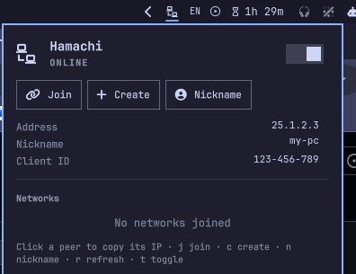

# omarchy-hamachi-plugin

An [Omarchy](https://omarchy.org/) bar widget for [LogMeIn Hamachi](https://vpn.net/): manage your Hamachi VPN from a small panel instead of the terminal.



## Features

- Bar icon shows whether Hamachi is online; the tooltip shows your Hamachi IP
- Go online / offline with a switch (or right-click the bar icon)
- Your address, nickname and client ID; click a value to copy it
- Joined networks with online peers, their IPs and connection type (direct / relay)
- Click a peer to copy its IP
- Join a network (ID + optional password), create a network, change your nickname
- Bring a network online/offline, leave it, or delete it if you own it (asks for a second click)
- Start the Hamachi daemon when it is stopped (via `pkexec`)
- English and Russian translations, following the Omarchy language setting

## Requirements

- Omarchy with the Quickshell-based shell
- [`logmein-hamachi`](https://aur.archlinux.org/packages/logmein-hamachi) from the AUR, with its `logmein-hamachi` systemd service
- `python3`
- `wl-clipboard` (`wl-copy`) for the copy actions

## Installation

1. Install Hamachi and start the daemon:

   ```bash
   omarchy pkg aur add logmein-hamachi
   sudo systemctl enable --now logmein-hamachi
   ```

2. Allow your user to control the daemon. Hamachi only accepts commands from root
   unless your login is listed in its override file:

   ```bash
   echo "Ipc.User $USER" | sudo tee -a /var/lib/logmein-hamachi/h2-engine-override.cfg
   sudo systemctl restart logmein-hamachi
   ```

3. Add the plugin and put it on the bar:

   ```bash
   omarchy plugin add https://github.com/danfimov/omarchy-hamachi-plugin.git --enable
   omarchy bar move io.github.danfimov.hamachi --section right
   ```

## Usage

| Where | Action | Result |
|-------|--------|--------|
| Bar icon | Left click | Open the panel |
| Bar icon | Right click | Go online / offline |
| Bar icon | Middle click | Copy your Hamachi IP |
| Panel | `t` / Enter | Go online / offline |
| Panel | `j` / `c` / `n` | Join a network / create a network / change nickname |
| Panel | `r` | Refresh |
| Panel | `Esc` | Close the form or the panel |

IPC, handy for keybindings:

```bash
omarchy-shell io.github.danfimov.hamachi toggle        # open / close the panel
omarchy-shell io.github.danfimov.hamachi form join     # open the panel on the join form
omarchy-shell io.github.danfimov.hamachi join <network-id>  # join form with the ID filled in
omarchy-shell io.github.danfimov.hamachi login         # also: logout, refresh, status
```

### Settings

In the widget's entry in `~/.config/omarchy/shell.json`:

| Key | Default | Description |
|-----|---------|-------------|
| `refreshIntervalSec` | `15` | How often to poll `hamachi` for status |

## How it works

`Panel.qml` never talks to Hamachi directly. It runs `hamachi-ctl.py`, which calls the
`hamachi` CLI with a fixed set of commands, validates network IDs and nicknames, and
returns JSON. Network passwords are only typed into the panel. They are passed to `hamachi` on
standard input (through an environment variable to the helper), so they never appear in
process arguments, and the IPC interface deliberately has no way to pass a password.
Each form keeps its own unsent input, so switching between Join and Create never
reuses a password typed into the other form.

## Removal

```bash
omarchy plugin remove io.github.danfimov.hamachi
```

Optionally undo the daemon permission by removing the `Ipc.User` line from
`/var/lib/logmein-hamachi/h2-engine-override.cfg` and restarting `logmein-hamachi`.

## License

[MIT](LICENSE)
